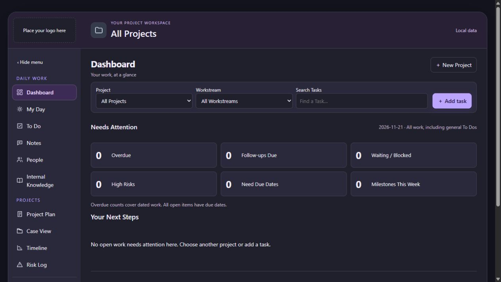

<p align="center">
  
</p>

<h1 align="center">Project Workspace</h1>

<p align="center"><strong>Your projects, notes and next actions. One place to keep work moving.</strong></p>

<p align="center">Run locally · Store records in SQLite · Start with an empty workspace</p>

<p align="center"><a href="#get-started">Get started</a> · <a href="#what-you-can-do">Explore the features</a> · <a href="docs/ai-connections.md">Connect an AI bot</a> · <a href="#your-data">Understand your data</a></p>



*The real interface, shown with an empty workspace. No personal or workplace records are included.*

Project Workspace brings daily tasks and longer projects together. See what needs attention, choose your next actions, keep the supporting notes nearby and export a project plan when you need to share it.

## What you can do

| Keep track of | How it helps |
| --- | --- |
| **My Day and To Do** | Focus on today's work and manage repeating tasks. |
| **Projects and milestones** | Organise workstreams, dates, owners and prerequisites. |
| **Dashboard and Timeline** | See overdue work, progress and upcoming deadlines. |
| **Notes and meetings** | Keep rich notes, checklists and meeting records alongside your work. |
| **Case View** | Bring a project's tasks and supporting notes into one view. |
| **People and Risk Log** | Link people to work and track risks with likelihood and impact. |
| **Internal Knowledge** | Keep reference articles and review proposed updates. |
| **Excel export and backups** | Download project plans and keep recoverable workspace copies. |

The public edition uses a standard system font and a **“Place your logo here”** placeholder. It starts empty; add your own projects when you are ready.

## Excel export: a fixed starting layout

The Excel format was built around the maintainer's own workflow and is deliberately limited. Project exports use a fixed plan, Risk log and Lists structure; this is not a configurable report designer or a full workspace backup. You can edit downloaded files in Excel, but changing future exports requires adapting the exporter code.

The public edition supplies no company logo or proprietary company font in its exports. Your own entered records, including names and notes, are still exported. [See the export scope and customisation guide](docs/excel-exports.md).

## Get started

You need **Git** and **Node.js 22.23.2** (the version used to check this release).

```powershell
git clone https://github.com/Memnarch90/project-workspace.git
cd project-workspace
npm ci
npm run build
npm start
```

Open **http://127.0.0.1:8767**. You should see the empty dashboard shown above. Add a project or a To Do, then refresh to check it was saved. Keep the terminal open while using the app; press **Ctrl+C** to stop it.

You can also download the source using GitHub's **Code → Download ZIP**, extract it, open a terminal in the extracted folder and run the last three commands.

## Connect an AI bot or harness

The hosted edition exposes an MCP server for clients supporting remote Streamable HTTP and OAuth. Start with read-only access and choose editing permissions only when needed.

[Read the AI connection guide](docs/ai-connections.md) for server settings, consent, safe test prompts, troubleshooting and data-sharing implications. The local browser server is not itself an MCP endpoint.

## Your data

Local use stores records in `workspace.sqlite3` under the `project-workspace-share` folder in Windows Local AppData, or under your home directory on other systems. The server listens on `127.0.0.1`, so it is available on your computer only. `WORKSPACE_DB` lets you choose a different database path.

- The repository contains source code, synthetic tests and the empty preview above. It does not include a working database, personal records or deployment credentials.
- Anyone with access to your local database file can read its records. It is not encrypted by the app. Keep databases and backups out of Git and shared folders.
- `npm ci` downloads the project's dependencies from the npm registry.
- This is a single-owner project. Corporate multi-user use, compliance and production hardening need a separate review.

## Optional cloud hosting

The included Cloudflare Worker uses **D1** for records, **KV** for OAuth state and **GitHub** for sign-in. These are optional for local use.

Copy `wrangler.example.jsonc` to `wrangler.jsonc` only when setting up your own deployment. Supply your own origin, GitHub user ID, database and KV IDs, and keep OAuth credentials in Cloudflare secrets. Cloudflare would store the records you enter and GitHub would handle sign-in. Review provider terms, costs and access before uploading workplace information. The hosting integration uses Cloudflare-specific services.

The public repository is separate from the maintainer's personal deployment and does not provide access to it.

## Checks and feedback

```powershell
npm run check:publish
npm run build
npm run check
```

The tests use synthetic records. The publishing check rejects known private assets, company branding in runtime files and recognised credential patterns; it is not a complete security audit.

Found a bug or have an idea? [Open an issue](https://github.com/Memnarch90/project-workspace/issues). Please leave personal records, employee information, access tokens and database exports out of public reports.

## Source publishing rule

Keep this edition neutral and empty. Do not add company logos, proprietary fonts, real workspace data, credentials or production deployment settings. Only publish explicitly reviewed source files; do not copy a private working directory into this repository.

## Licence

The source is publicly viewable. No project licence has been selected yet; public visibility alone does not grant a general licence to reuse or redistribute it.
